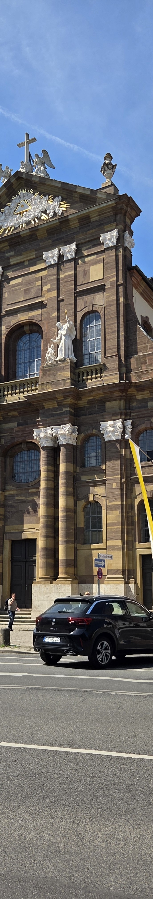
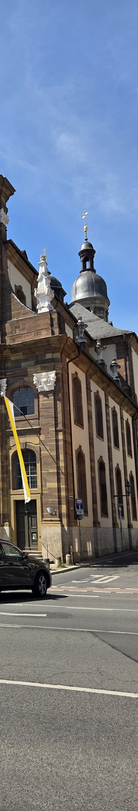
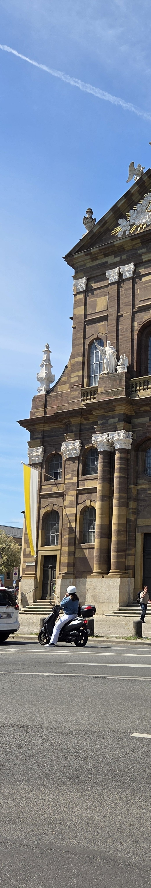
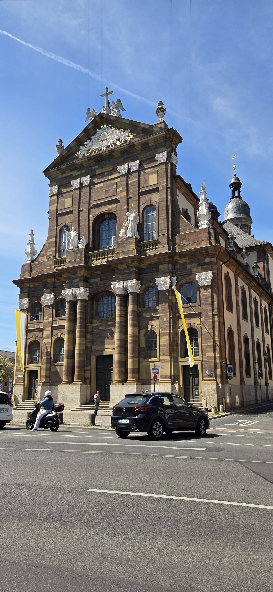

# Multi-Image Panorama Stitching with RANSAC & Alpha Blending

This module implements an end-to-end multi-image panorama stitching and mosaic pipeline using feature detection, Lowe's ratio test matching, RANSAC projective homography estimation, and Euclidean distance transform feather blending.

---

## Visual Pipeline & Results

The pipeline processes three sequential overlapping exposures of St. Michael's Church in Würzburg, Germany:

| Input 1: Left (`inputs/pt2.jpg`) | Input 2: Middle (`inputs/pt1.jpg`) | Input 3: Right (`inputs/pt3.jpg`) |
| :---: | :---: | :---: |
|  |  |  |

### Final Stitched & Blended Panorama (`1848 × 4002 px`)

<p align="center">
  
</p>

---

## Technical Methodology

1. **Feature Extraction & Description:**
   - **SIFT (Scale-Invariant Feature Transform):** Computes DoG extrema across 5 octave layers (`sigma = 1.4`, `contrastThreshold = 0.03`, `edgeThreshold = 12`) to detect rotation- and scale-invariant interest points.
   - **ORB (Oriented FAST and Rotated BRIEF):** Benchmarked as a computationally efficient binary alternative.

2. **Descriptor Matching & Pruning:**
   - **FLANN-based Matcher:** Employs randomized KD-trees (`trees = 12`, `checks = 150`) for fast nearest-neighbor search.
   - **Lowe's Ratio Test:** Filters ambiguous matches by rejecting candidates where $d_{\text{best}} \ge 0.65 \cdot d_{\text{second\_best}}$.

3. **Geometric Estimation via RANSAC:**
   - Computes the 8-DOF Projective Homography matrix $H$:
     $$\mathbf{x}' \sim H \mathbf{x}$$
   - Uses RANSAC with reprojection error threshold of $3.0\text{ px}$ and $99.9\%$ confidence over up to 5,000 iterations to isolate genuine inlier correspondences.

4. **Distance Transform Feather Blending:**
   - Eliminates hard exposure edges and photometric seams by calculating the Euclidean distance transform ($L_2$) of both image masks:
     $$\alpha_L = \frac{D_L(x,y)}{D_L(x,y) + D_R(x,y) + \epsilon}, \quad \alpha_R = 1 - \alpha_L$$
   - Multi-band smoothing hides illumination mismatches without ghosting or loss of high-frequency detail.

---

## Files in this Directory

| File | Description |
| :--- | :--- |
| [`Stitching.ipynb`](Stitching.ipynb) | **Interactive Jupyter Notebook** (natively viewable on GitHub with all code and outputs). |
| [`Stitching.pdf`](Stitching.pdf) | **Full 53-page Technical Report** detailing SIFT vs. ORB, inlier counts, and blending proofs. |
| [`Stitching.html`](Stitching.html) | **Full HTML Export** from Jupyter. *Note:* GitHub renders `.html` as source code. To view interactively in your browser, open locally or via [HTMLPreview](https://htmlpreview.github.io/?https://github.com/RamezM2004/machine-intelligence-2-coursework/blob/main/03-Panorama-Image-Stitching/Stitching.html). |
| [`final_stitched_panorama.jpg`](final_stitched_panorama.jpg) | High-resolution final stitched panorama (`1848 × 4002 px`). |
| [`inputs/`](inputs/) | Sequence input slices (`pt1.jpg`, `pt2.jpg`, `pt3.jpg`) plus reference multi-angle campus & landmark photos (`Schweinfurt.jpg`, `GJU.jpg`, `Wurzburg.jpg`, `Part1.jpg`–`Part3.jpg`). |

---

## Running the Notebook

```bash
# From repository root
cd 03-Panorama-Image-Stitching
jupyter notebook Stitching.ipynb
```
