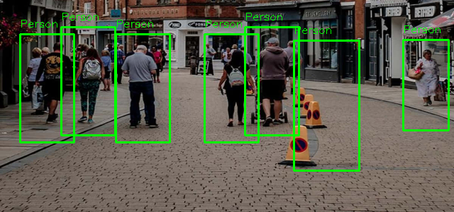

# Pedestrian Detection, Optical Flow Tracking, & Lane Detection

This module implements classical computer vision pipelines for intelligent transportation and autonomous perception:
1. **Pedestrian Detection:** Multi-scale sliding window with Histogram of Oriented Gradients (HOG) and Linear Support Vector Machine (SVM).
2. **Motion Tracking:** Sparse optical flow feature tracking using the Lucas-Kanade differential method.
3. **Lane Detection:** Canny edge filtering, Region-of-Interest (ROI) masking, and Probabilistic Hough Transform line fitting.

---

## Visual Detection Results

<p align="center">
  
</p>

*Figure: Multi-scale pedestrian localization using HOG descriptors, Linear SVM classification, and Non-Maximum Suppression (NMS) on a dense urban pedestrian street.*

---

## Technical Implementations

### 1. Pedestrian Detection (HOG + Linear SVM)
- **Feature Extraction:** Computes 1D gradient orientation histograms across spatial cells:
  - Gradient orientation bins: 9
  - Cell size: $8 \times 8\text{ pixels}$
  - Block normalization: $2 \times 2\text{ cells}$ with $L_2\text{-Hys}$ normalization
- **Sliding Window:** Evaluates image patches across multiple spatial scales to handle scale variation of pedestrians at varying distances.
- **Classification:** Trained a `LinearSVC` model to distinguish pedestrian signatures from background negative clutter.
- **Non-Maximum Suppression (NMS):** Evaluates Intersection over Union (IoU) overlap to suppress duplicate multi-scale detections and output high-confidence bounding boxes.

### 2. Temporal Motion Tracking (Lucas-Kanade Optical Flow)
- Assumes local brightness constancy and small displacement:
  $$I(x,y,t) = I(x + \delta x, y + \delta y, t + \delta t)$$
- Tracks salient corner features (`cv2.goodFeaturesToTrack`) across temporal video frames using multi-level pyramidal Lucas-Kanade optical flow (`cv2.calcOpticalFlowPyrLK`).
- Plots persistent centroid trajectory tails using double-ended queue (`deque`) coordinate buffers.

### 3. Ego-Lane Boundary Detection (Hough Transform)
- Isolates roadway boundaries from dashboard camera footage:
  - High-frequency edge localization via Sobel/Canny gradient operators.
  - Perspective Region of Interest (ROI) masking to exclude surrounding sky, buildings, and oncoming lanes.
  - Line parametrization in Hough parameter space ($r = x \cos \theta + y \sin \theta$) via Probabilistic Hough Line Transform (`cv2.HoughLinesP`).

---

## Files in this Directory

| File | Description |
| :--- | :--- |
| [`Pedestrian_Detection_and_Tracking.ipynb`](Pedestrian_Detection_and_Tracking.ipynb) | Complete automated assignment pipeline covering pedestrian detection, lane fitting, and Lucas-Kanade flow. |
| [`HOG_SVM_Custom_Implementation.ipynb`](HOG_SVM_Custom_Implementation.ipynb) | Custom implementation notebook with manual sliding window generator, HOG feature extraction, and Linear SVM training. |
| [`pedestrian_detected.png`](pedestrian_detected.png) | Annotated street scene image demonstrating final detection bounding boxes. |
| [`input_street_scene.jpg`](input_street_scene.jpg) | High-resolution input urban street scene used for feature evaluation. |
| [`lk_optical_flow_tracking.mp4`](lk_optical_flow_tracking.mp4) | Video demonstration of Lucas-Kanade optical flow tracking. |
| [`lane_detection_hough.mp4`](lane_detection_hough.mp4) | Video demonstration of ego-lane boundary detection. |
| [`pedestrian_output.mp4`](pedestrian_output.mp4) | Video demonstration of continuous temporal pedestrian detection. |

---

## Running the Notebooks

```bash
# From repository root
cd 05-Pedestrian-Detection-and-Tracking
jupyter notebook Pedestrian_Detection_and_Tracking.ipynb
```
